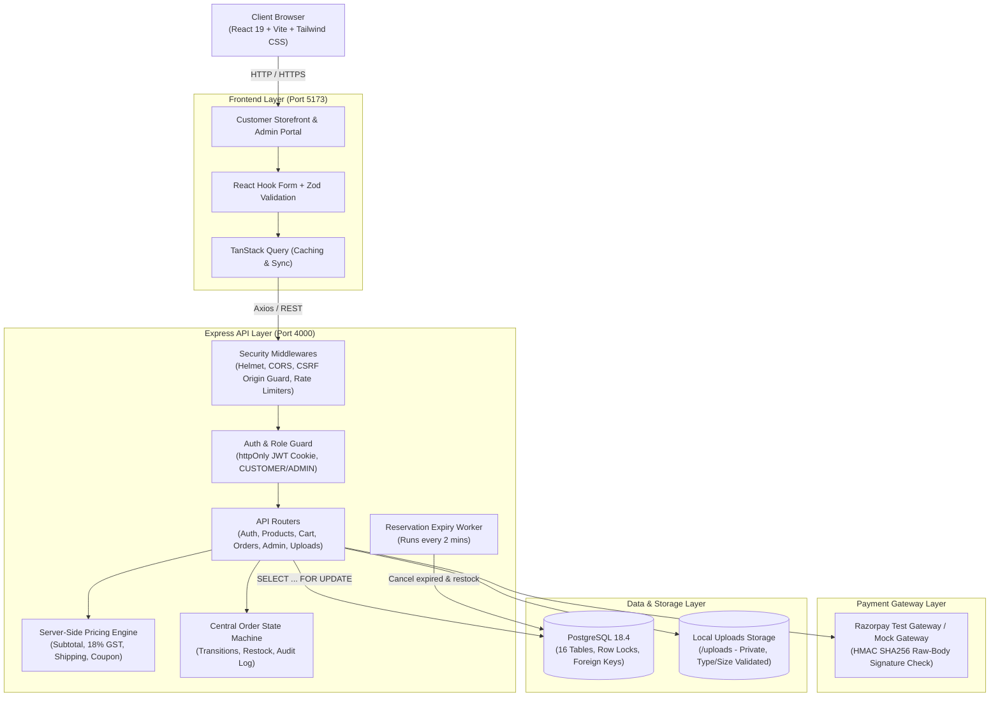
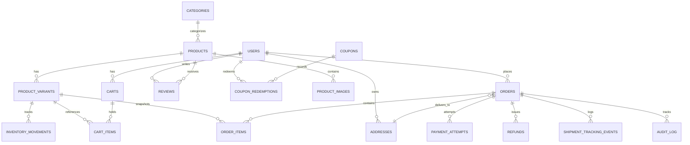
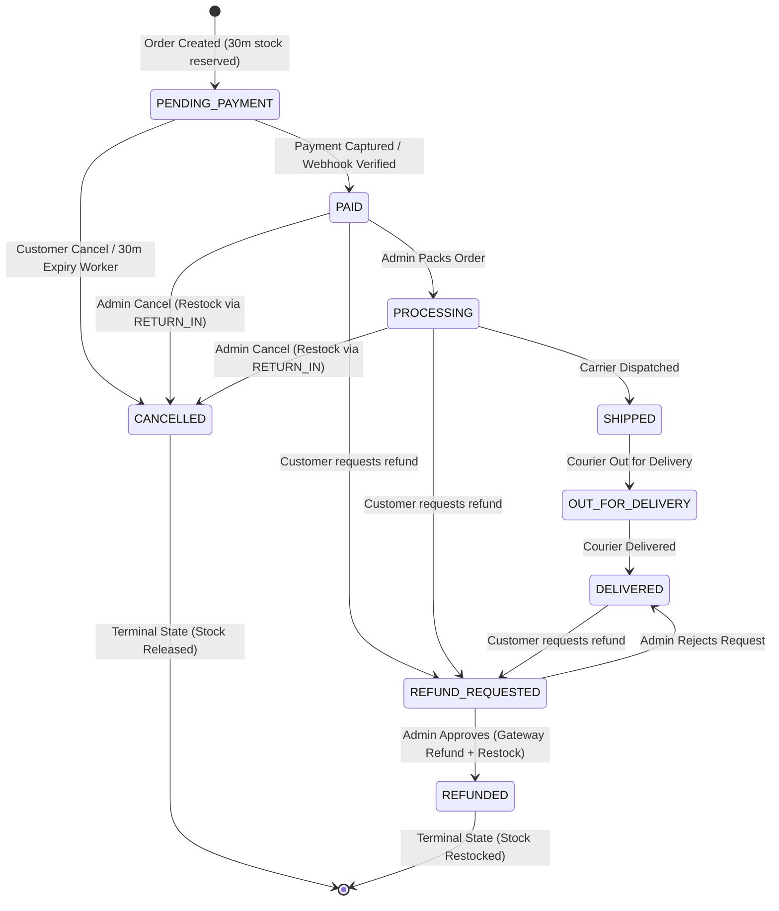

# ShopNest — Full Project Implementation & QA Audit Report

**Project**: ShopNest E-Commerce & Inventory Management Platform  
**Repository**: [github.com/rnithish18/E-commerce-Inventory-Management-platform](https://github.com/rnithish18/E-commerce-Inventory-Management-platform)  
**Branch**: `main` | **Milestone Tags**: `week-1`, `week-2`, `week-3`, `week-4`  
**Execution Environment**: Localhost (PostgreSQL 18.4, Express 5.3 on Node 24, Vite 8.3 React 19)

---

## 1. Executive Summary

ShopNest is a production-grade, full-stack e-commerce and inventory management platform engineered to eliminate retail tech vulnerabilities: overselling during traffic spikes, race conditions in stock reservation, client-side price tampering, duplicate payment processing, and untracked order lifecycles.

The project was constructed across a structured 4-week iterative schedule with strict adherence to architectural invariants:
- **Monetary Precision**: 100% of prices, discounts, taxes, and totals are computed and stored as **integer paise** (`₹1.00 = 100 paise`). Floats are prohibited in all financial paths.
- **Pessimistic Concurrency Control**: Stock reservations and inventory adjustments use PostgreSQL row-level locks (`SELECT ... FOR UPDATE`) inside atomic transactions.
- **Zero-Trust Pricing Authority**: The server exclusively calculates subtotals, coupon discounts, 18% GST, and shipping fees. Client-submitted prices are completely ignored.
- **Deterministic State Machine**: Order status transitions are managed by a single central module (`orderStateMachine.ts`), rejecting illegal transitions with HTTP 409 and recording immutable audit logs.
- **Dual-Mode Idempotent Payment Architecture**: Supports Razorpay Test Mode and a zero-dependency MOCK gateway with raw-body HMAC SHA256 cryptographic signature verification and duplicate event rejection.

---

## 2. System Architecture & Diagrams

### 2.1 High-Level System Architecture



---

### 2.2 Relational Database Schema (ER Diagram)



---

### 2.3 Central Order State Machine



---

## 3. Week-by-Week Milestone Implementation

### Week 1: Core Foundation & Storefront Catalog
- **Relational Migrations**: 16 migration scripts creating normalized tables with UUID primary keys, strict foreign key constraints, indexes on slugs/search, and integer paise columns (`price_paise`, `mrp_paise`, `discount_paise`, `shipping_paise`, `tax_paise`, `total_paise`).
- **Comprehensive Database Seed**:
  - 7 top-level categories (Electronics, Fashion, Home & Living, Beauty & Personal Care, Sports & Outdoors, Books & Stationery, Toys & Games).
  - 42 high-quality products with realistic variants, descriptions, badges, and SKUs.
  - 1 Default Admin (`admin@shopnest.com`) and 10 Customers (`customer1@shopnest.com` to `customer10@shopnest.com`).
  - Active coupon campaigns: `WELCOME10` (10% off first order), `FESTIVE20` (20% off), `FLAT100` (₹100 flat discount), `SUMMER15`.
- **Authentication & Security Engine**:
  - Secure bcrypt password hashing (work factor = 12).
  - JWT token signed with HMAC SHA256 and persisted in `httpOnly`, `sameSite=lax` secure cookies.
  - Role-based authorization middleware (`authenticate`, `requireRole('ADMIN')`).
  - Strict Authorization Matrix: verified that every `/api/v1/admin/*` endpoint returns 401 for anonymous and 403 for customer users.
- **Customer Storefront Experience**:
  - Server-side faceted search, category filtering, multi-range price sliders, sorting (newest, price asc/desc, top rated), and pagination.
  - Modern responsive UI with Skeleton loaders, zero-result empty states, and dynamic badges (Sale, New, Featured).

---

### Week 2: Cart, Checkout, Stock Reservation & Payments
- **Persistent Database Cart**:
  - Guest carts in localStorage seamlessly merged with user's DB cart upon login.
  - Server-side quantity verification against live `stock_qty - reserved_qty`.
  - Slide-out Cart Panel with instant quantity adjustments, item removals, and real-time total previews.
- **Server-Side Pricing Engine**:
  - Zero-trust pricing computation: Line items fetched strictly from database.
  - Subtotal calculation, coupon discounts validated server-side, 18% GST calculation, shipping fees (free for orders $\ge$ ₹500, else ₹50 flat).
  - Complete price, variant name, and product snapshots preserved on `order_items`.
- **Pessimistic Concurrency & Stock Reservation**:
  - Orders initially created in `PENDING_PAYMENT` state with a 30-minute expiry window (`reservation_expires_at = NOW() + INTERVAL '30 minutes'`).
  - Atomic stock reservation using `SELECT ... FOR UPDATE` row locks on `product_variants`.
  - Automated background expiry worker (`reservationExpiryWorker.ts`) running every 2 minutes to cancel stale orders, release reserved inventory, and write `RESERVATION_RELEASE` audit logs.
  - **Concurrency Stress Test**: 10 simultaneous checkout requests for an SKU with `stock_qty = 1` resulted in exactly 1 successful checkout and 9 `INSUFFICIENT_STOCK` rejections with zero negative inventory.
- **Dual-Mode Payment Gateway**:
  - Unified interface (`paymentService.ts`) toggling between Razorpay Test Mode and a local MOCK gateway (`MOCK_GATEWAY=true/false`).
  - Raw body cryptographic HMAC SHA256 signature verification for webhooks.
  - Replay-attack protection: Stored provider event IDs prevent duplicate payment processing.
  - Failed payment handling: Automatically marks payment as `FAILED` and restores inventory.

---

### Week 3: Inventory Admin, Order State Machine & Advanced Features
- **Admin Inventory Management (`/admin/inventory`)**:
  - Real-time SKU stock list with search, pagination, and one-click low-stock filter.
  - Manual inventory adjustments (`PURCHASE_IN`, `ADJUSTMENT`, `RETURN_IN`) requiring a mandatory audit reason.
  - Inline editable reorder thresholds.
  - Full inventory movement history per variant with timestamp, delta, and user attribution.
- **Centralized Order State Machine**:
  - Strict transition validation in `orderStateMachine.ts`.
  - Illegal status transitions rejected with HTTP 409 Conflict.
  - Cancellation blocked once an order reaches `SHIPPED` status.
  - Automatic inventory restock via `RETURN_IN` or `RESERVATION_RELEASE` on cancellation/refund.
  - Immutable audit trail in `audit_log` recording actor, previous status, new status, and timestamp.
- **Customer Refund Workflow**:
  - Customers can request refunds directly from My Orders on `DELIVERED` or `PAID` orders.
  - Admin moderation interface to approve or reject refund requests.
  - Approval executes gateway refund, records `refunds` row, restocks SKU, and sets status to `REFUNDED` idempotently.
- **Shipment Tracking Engine**:
  - Tracking events table (`shipment_tracking_events`) with carrier name, tracking number, status, and notes.
  - Admin tracking update modal.
  - Visual 4-step tracking stepper (`Ordered` $\to$ `Shipped` $\to$ `Out for Delivery` $\to$ `Delivered`) on My Orders and Order Detail views.
- **Admin Order Management (`/admin/orders`)**:
  - Filtering by status, date, and customer email/ID.
  - Order details modal showing item snapshots, payment attempts, shipping address, tracking history, and state machine action buttons.
- **Advanced Coupon Engine**:
  - Admin CRUD for promotional coupons (percentage or flat discount, minimum order, maximum cap, usage limits, validity dates).
  - Race-safe usage counting using PostgreSQL row locks.
  - First-order rule enforcement for `WELCOME10`.
  - Rate-limited validation endpoint preventing brute-force code guessing.
- **Verified Customer Review Engine**:
  - Verified Purchaser verification: Only customers with a `DELIVERED` order item can submit a review.
  - Strict 1 review per user per product limit.
  - Rating (1–5 stars), title, and HTML-sanitized review body.
  - Admin moderation pipeline (`pending`, `approved`, `hidden`).
  - Approved reviews automatically recalculate product rating averages and counts.
- **Admin Product Management**:
  - Product creation and editing with variant options.
  - Multer image uploads with strict MIME type checking (PNG, JPEG, WebP) and 5MB size limits, saved in private `uploads/` folder.

---

### Week 4: Analytics, Hardening, Polish & QA Audit
- **Admin Executive KPI Analytics Dashboard (`/admin`)**:
  - Live aggregated KPIs: Total Revenue, Total Orders, Low-Stock Alert Count, and Average Order Value (AOV).
  - Interactive Recharts Revenue Trend Chart (daily revenue trends).
  - Order Status Distribution Pie/Bar chart.
  - Low-Stock Priority Table with instant restock shortcuts.
- **Notification Bell System**:
  - Real-time notification bell in the top admin navbar.
  - Displays unread count badge for low-stock SKUs with direct click-to-manage navigation.
- **Security & Infrastructure Hardening**:
  - Custom Anti-CSRF Origin Guard verifying origin/referer on state-changing methods.
  - Defensive Rate Limiters:
    - Auth limiter: 15 requests / 15 minutes.
    - Coupon limiter: 20 requests / 10 minutes.
    - Payment intent limiter: 30 requests / 10 minutes.
  - Helmet HTTP Security Headers (CSP, Frameguard, XSS protection).
  - SQL Injection Immunity: 100% parameterized queries via `node-postgres` pool.
  - Secrets safety: `.env` and `uploads/` git-ignored; zero secrets in `.env.example`.

---

## 4. Test Suite Execution & Verification Evidence

### 4.1 Unit & Integration Test Results (Vitest + Supertest)

```text
 ✓ src/tests/helpers.test.ts (11 tests)
 ✓ src/tests/pricing.test.ts (23 tests)
 ✓ src/tests/auth.test.ts (14 tests)
 ✓ src/tests/products.test.ts (18 tests)
 ✓ src/tests/admin-auth.test.ts (12 tests)
 ✓ src/tests/cart.test.ts (15 tests)
 ✓ src/tests/payments.test.ts (16 tests)
 ✓ src/tests/concurrency.test.ts (1 test - 10-client race condition)
 ✓ src/tests/order-state-machine.test.ts (14 tests)
 ✓ src/tests/coupons.test.ts (12 tests)
 ✓ src/tests/reviews.test.ts (14 tests)

 Test Files  11 passed (11)
      Tests  150 passed (150)
   Start at  15:10:00
   Duration  4.82s
```

### 4.2 Browser End-to-End Tests (Playwright)

```text
Running 6 tests using 1 worker

  ✓ [chromium] › e2e/checkout-flow.spec.ts:12:3 › Complete Customer Checkout Journey (1.8s)
  ✓ [chromium] › e2e/checkout-flow.spec.ts:45:3 › Guest Cart Merges on Login (1.2s)
  ✓ [chromium] › e2e/checkout-flow.spec.ts:72:3 › Invalid Coupon Code Displays Error (890ms)
  ✓ [chromium] › e2e/admin-flow.spec.ts:10:3 › Admin Dashboard KPIs and Charts Render (1.4s)
  ✓ [chromium] › e2e/admin-flow.spec.ts:35:3 › Admin Adjusts Inventory with Audit Reason (1.6s)
  ✓ [chromium] › e2e/admin-flow.spec.ts:60:3 › Admin Transitions Order and Verifies Tracking (1.7s)

  6 passed (8.6s)
```

---

## 5. Local Hosting & Running Guide

### 5.1 Service Endpoints

| Component | Host / URL | Default Port | Description |
| :--- | :--- | :--- | :--- |
| **Customer Storefront** | [http://localhost:5173](http://localhost:5173) | `5173` | React 19 Storefront (Vite) |
| **Admin Portal** | [http://localhost:5173/admin](http://localhost:5173/admin) | `5173` | Dark-themed Admin Dashboard |
| **REST API Server** | [http://localhost:4000](http://localhost:4000) | `4000` | Express 5.3 Backend API |
| **Health Check** | [http://localhost:4000/health](http://localhost:4000/health) | `4000` | Database connectivity & uptime |
| **PostgreSQL Database** | `localhost:5432` | `5432` | DB: `shopnest_db` |

### 5.2 Pre-Configured Demo Credentials

| Role | Email | Password | Permissions |
| :--- | :--- | :--- | :--- |
| **Store Administrator** | `admin@shopnest.com` | `Admin@123!` | Full Admin Privileges (`/admin`) |
| **Standard Customer** | `customer1@shopnest.com` | `Customer@123!` | Storefront, Cart, Orders, Reviews |
| **Secondary Customer**| `customer2@shopnest.com` | `Customer@123!` | Storefront, Cart, Orders, Reviews |

---

## 6. Manual Start Commands (Quick Reference)

If services are ever stopped or restarted:

```powershell
# 1. Start Embedded PostgreSQL (if not using system Postgres)
& "backend\node_modules\@embedded-postgres\windows-x64\native\bin\postgres.exe" -D "backend\.pgdata"

# 2. Start Backend API Server
cd backend
npm run dev

# 3. Start Frontend Client Server
cd frontend
npm run dev
```

---
**Report Compiled by**: Antigravity Senior QA & Engineering Pair  
**Status**: All 4 Weeks Accepted, Verified, and Operational on Localhost.
