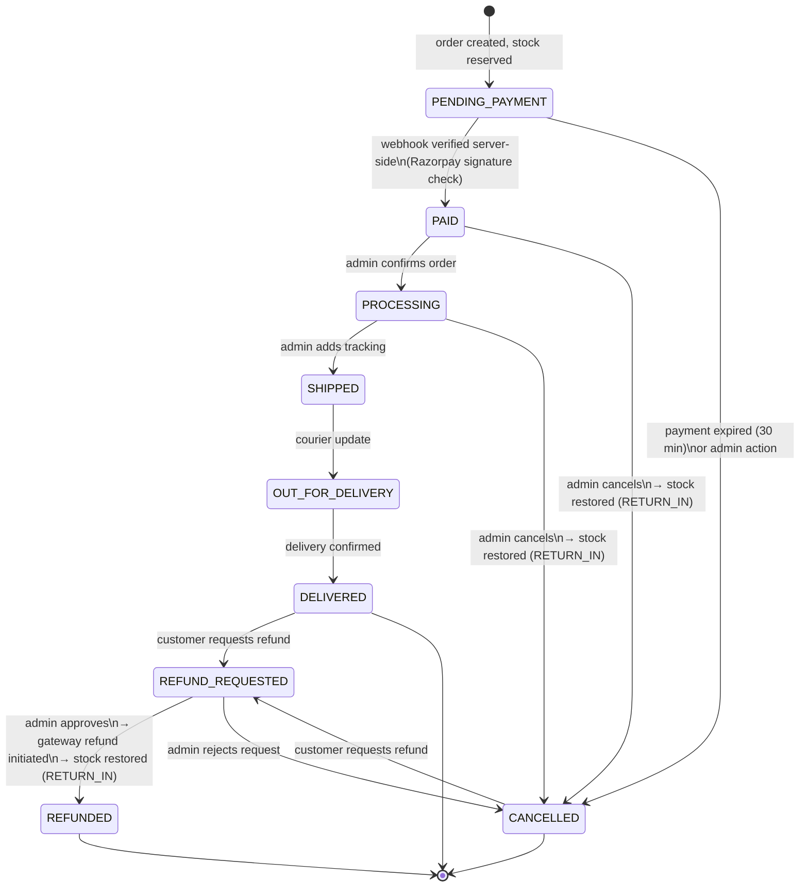
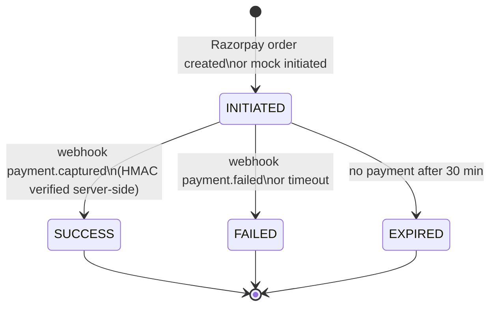
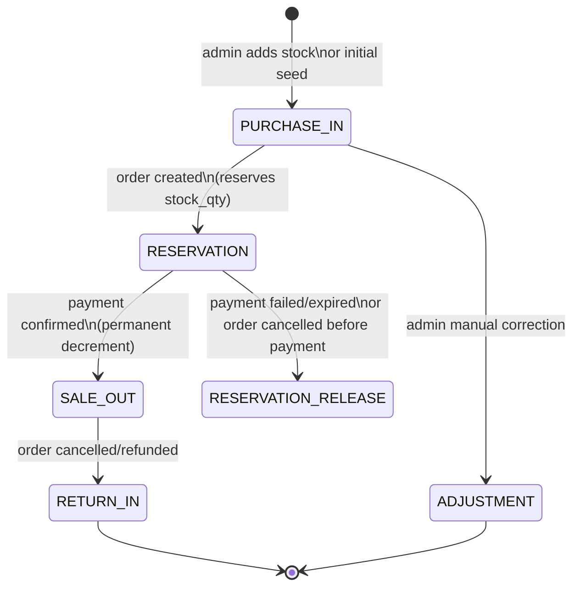
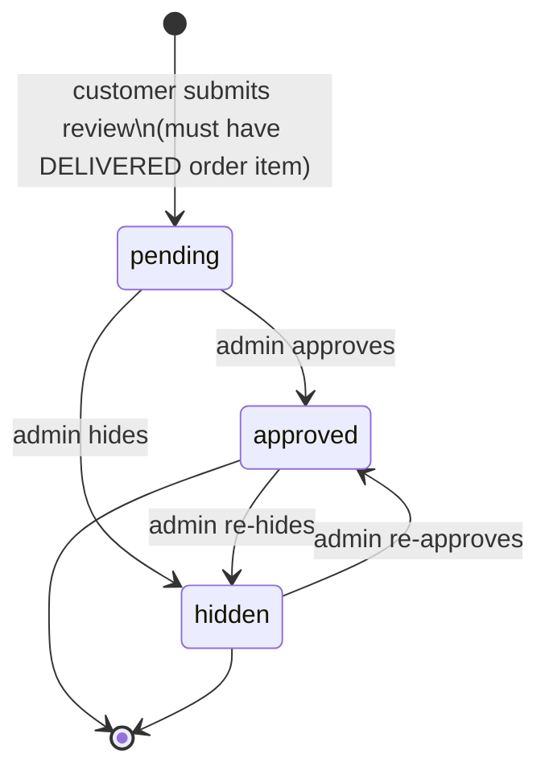
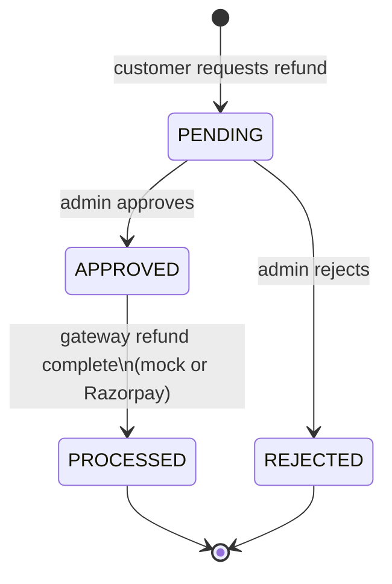

# ShopNest — Status Diagrams

## 1. Order Status State Machine

### Transition Rules (enforced server-side)

| From | To | Actor | Stock Effect |
|------|----|-------|-------------|
| `PENDING_PAYMENT` | `PAID` | System (webhook) | `RESERVATION` → `SALE_OUT` |
| `PENDING_PAYMENT` | `CANCELLED` | System/Admin | `RESERVATION_RELEASE` |
| `PAID` | `PROCESSING` | Admin | None |
| `PAID` | `CANCELLED` | Admin | `RETURN_IN` |
| `PROCESSING` | `SHIPPED` | Admin | None |
| `PROCESSING` | `CANCELLED` | Admin | `RETURN_IN` |
| `SHIPPED` | `OUT_FOR_DELIVERY` | Admin | None |
| `OUT_FOR_DELIVERY` | `DELIVERED` | Admin | None |
| `DELIVERED` | `REFUND_REQUESTED` | Customer | None |
| `CANCELLED` | `REFUND_REQUESTED` | Customer | None |
| `REFUND_REQUESTED` | `REFUNDED` | Admin | `RETURN_IN` |
| `REFUND_REQUESTED` | `CANCELLED` | Admin | None |

---

## 2. Payment Status State Machine

### Payment Idempotency

- `provider_payment_id` has a `UNIQUE` constraint
- Duplicate webhook events are silently ignored (return 200)
- Only `SUCCESS` triggers order → `PAID` transition
- Client-side success redirect **never** marks an order paid
- HMAC-SHA256 signature verified using `RAZORPAY_WEBHOOK_SECRET`

---

## 3. Inventory Movement Types

### Stock Ledger Rules

Every stock change **must** write an `inventory_movements` row with:
- `stock_before` — snapshot before change
- `stock_after` — snapshot after change
- `quantity_change` — signed integer (negative for decrements)
- `reference_id` + `reference_type` — links to order, adjustment, etc.
- `actor_user_id` — who triggered it
- `created_at` — UTC timestamp

All stock changes happen inside **database transactions** with `SELECT ... FOR UPDATE` row locking to prevent race conditions.

---

## 4. Review Status

### Review Eligibility Rules
- User must have an order item for the product in a `DELIVERED` order
- One review per `(product_id, user_id)` — enforced by UNIQUE constraint
- `order_item_id` is UNIQUE in reviews — prevents one item getting two reviews
- Review body is HTML-stripped before storage

---

## 5. Refund Status

