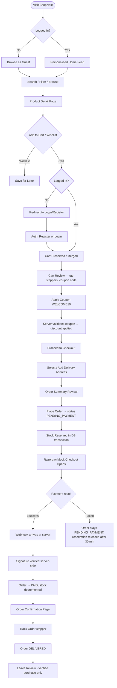
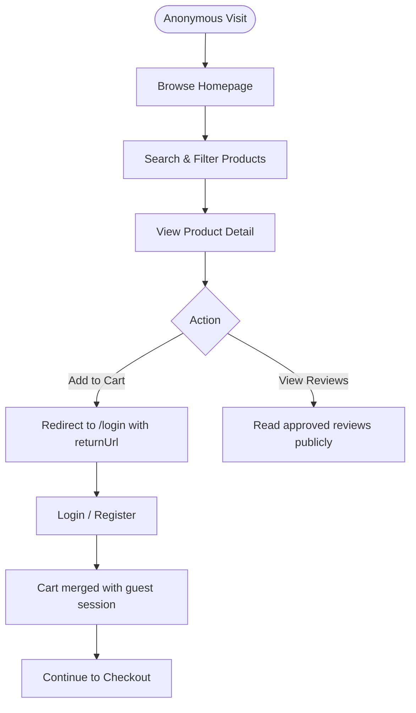

# ShopNest — User Journey Maps

## 1. Customer Journey

### Key Customer Pages
| Page | Route | Auth Required |
|------|-------|---------------|
| Home | `/` | No |
| Shop Catalog | `/shop` | No |
| Product Detail | `/product/:slug` | No |
| Cart | `/cart` | Yes |
| Checkout | `/checkout` | Yes |
| Order Confirmation | `/order/:id/confirmation` | Yes |
| My Orders | `/orders` | Yes |
| Order Tracking | `/orders/:id` | Yes |
| Wishlist | `/wishlist` | Yes |
| Profile | `/profile` | Yes |
| Login | `/login` | No |
| Register | `/register` | No |

---

## 2. Admin Journey

```mermaid
flowchart TD
    A([Admin Login]) --> B[Admin Dashboard]
    B --> C{Choose Section}

    C --> D[Products]
    D --> D1[Create Product with images]
    D --> D2[Edit / Deactivate Product]
    D --> D3[Manage Product Images]

    C --> E[Orders]
    E --> E1[Filter by status]
    E --> E2[View Order Detail + Audit Timeline]
    E --> E3[Update Status: PAID → PROCESSING → SHIPPED etc.]
    E --> E4[Cancel Order → restock]
    E --> E5[Approve Refund Request]

    C --> F[Inventory]
    F --> F1[View Stock Levels per SKU]
    F --> F2[Manual Adjustment with reason]
    F --> F3[Set Reorder Thresholds]
    F --> F4[View Movement History]
    F --> F5[Low Stock Alerts Dashboard]

    C --> G[Customers]
    G --> G1[View Customer List]
    G --> G2[View Customer Orders]

    C --> H[Coupons]
    H --> H1[Create percent/flat coupon]
    H --> H2[Set limits, expiry, min order]
    H --> H3[View redemption stats]
    H --> H4[Activate / Deactivate]

    C --> I[Reviews]
    I --> I1[Pending review queue]
    I --> I2[Approve / Hide reviews]
    I --> I3[Flag abusive content]

    C --> J[Analytics]
    J --> J1[KPI Cards with period comparison]
    J --> J2[Sales & Orders chart]
    J --> J3[Top products table]
    J --> J4[Inventory exposure report]
```

### Key Admin Pages
| Page | Route | Role |
|------|-------|------|
| Dashboard | `/admin` | ADMIN |
| Products | `/admin/products` | ADMIN |
| Add Product | `/admin/products/new` | ADMIN |
| Orders | `/admin/orders` | ADMIN |
| Order Detail | `/admin/orders/:id` | ADMIN |
| Inventory | `/admin/inventory` | ADMIN |
| Customers | `/admin/customers` | ADMIN |
| Coupons | `/admin/coupons` | ADMIN |
| Reviews | `/admin/reviews` | ADMIN |
| Analytics | `/admin/analytics` | ADMIN |
| Settings | `/admin/settings` | ADMIN |

---

## 3. Guest Journey

---

## 4. State Transitions Summary

### Order Status Flow
`PENDING_PAYMENT → PAID → PROCESSING → SHIPPED → OUT_FOR_DELIVERY → DELIVERED`

Cancellable from: `PAID`, `PROCESSING`  
Refund path: `CANCELLED` or `DELIVERED` → `REFUND_REQUESTED` → `REFUNDED`

### Stock Flow
1. `PURCHASE_IN` — initial stock, admin restock
2. `RESERVATION` — stock reserved when order created (PENDING_PAYMENT)
3. `SALE_OUT` — stock decremented when order becomes PAID
4. `RESERVATION_RELEASE` — reservation freed if payment fails or order expires
5. `RETURN_IN` — stock restored on cancel/refund
6. `ADJUSTMENT` — manual admin correction with reason
